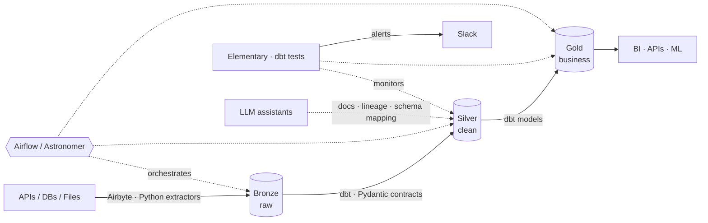

<!-- HEADER -->
<div align="center">


<a href="https://github.com/nandodevs">
  
</a>

<br/>

[](https://linkedin.com/in/sisnando-junior)
[](https://brook-bay-469.notion.site/sisnando-portfolio)
[](https://medium.com/@sis_data)


</div>

---

## 🧭 About

I build **scalable, observable, contract-driven data platforms**. I bring software engineering rigor (typing, tests, CI/CD) to the Modern Data Stack, and I use AI to remove manual work from the data lifecycle.

```python
from dataclasses import dataclass, field

@dataclass
class SisnandoJunior:
    role: str = "Senior Data Engineer @ Zenvia"
    languages: tuple = ("Python", "SQL")
    paradigms: tuple = ("Medallion", "Event-Driven", "Data Contracts", "DataOps")
    obsessions: list = field(default_factory=lambda: [
        "Data quality & observability",
        "Type-safe pipelines",
        "Developer experience for data teams",
        "AI-augmented workflows",
    ])

    def mission(self) -> str:
        return "Make data trustworthy, fast and boring (in production)."
```

<table>
<tr>
<td width="50%" valign="top">

### 🏗️ What I do
- Multi-tenant ingestion engines
- Dimensional and layered modeling
- End-to-end governance and lineage
- CI/CD, testing and modular codebases for data

</td>
<td width="50%" valign="top">

### 🛡️ What I care about
- Automated tests and anomaly detection
- SLA tracking and Slack alerting
- `Elementary` + `dbt tests`
- Schemas validated with `Pydantic`

</td>
</tr>
</table>

---

## 🎯 Current Focus

| | Pillar | Focus & Tech |
| :-: | :-- | :-- |
| 🐍 | **Modern Python for Data** | `DuckDB` · `Polars` · `Pydantic` · `uv` / `poetry` · `pytest` |
| 🤖 | **AI-Augmented DataOps** | LLM-generated docs, lineage audits, smart schema mapping, AI-assisted code review |
| 🔄 | **Automated ELT & Ingestion** | Custom Python extractors, Airbyte connectors, rate-limit handling, idempotent loads |
| 🛡️ | **Observability & Governance** | Anomaly detection, drift monitoring, automated metadata pipelines |

---

## 🧩 Reference Architecture



---

## 🛠️ Tech Stack

<div align="center">

**Languages & Python ecosystem**


**Orchestration, transformation & ingestion**


**Cloud, warehouses & databases**


**AI & Automation**


</div>

---

## 🚀 Featured Projects

<table>
<tr>
<td width="50%" valign="top">

### 🎬 [kdrama_analytics_project](https://github.com/nandodevs/kdrama_analytics_project)
End-to-end analytics pipeline: ingestion, modeling and data tests.

`Python` `dbt` `Airflow` `PostgreSQL`

</td>
<td width="50%" valign="top">

### 📊 [investimentos-govbr-dataeng](https://github.com/nandodevs/investimentos-govbr-dataeng)
Engineering and observability over public federal investment data.

`Python` `Pandas` `SQL` `Docker`

</td>
</tr>
</table>

---

## 📊 GitHub Stats

<div align="center">


<br/>


</div>

---

<div align="center">

### 💬 Let's connect

Open to talk about **Data Reliability**, **Analytics Engineering**, **Python for Data** and **AI in the data stack**.

[](https://linkedin.com/in/sisnando-junior)


</div>
